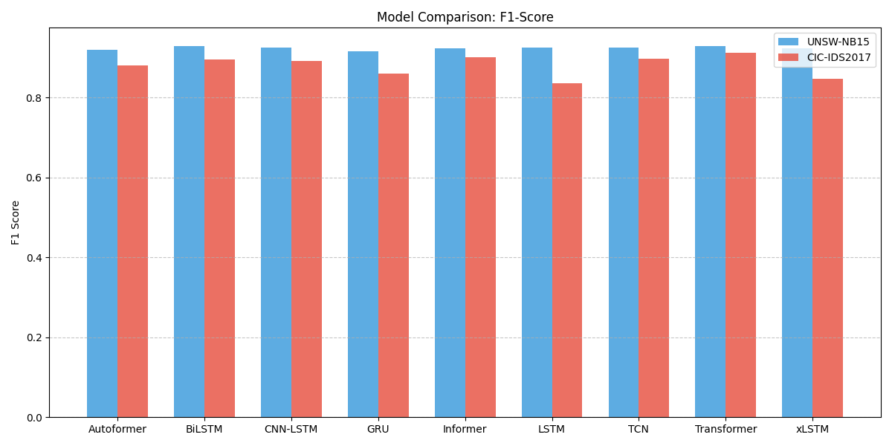

# Network Anomaly Detection with Long-Horizon Sequences

This project implements and evaluates multiple deep learning models for binary
network anomaly detection using two major datasets: **UNSW-NB15** and
**CIC-IDS2017**. The goal is to compare standard architectures with the **xLSTM
(extended memory LSTM)** model across different network environments.

## Project Structure

- `models.py`: Unified implementation of all deep learning architectures.
- `datasets/`: Data storage (Smaller files included, larger ones linked below).
- `UNSW-NB15/`: Preprocessing and training scripts for the UNSW-NB15 dataset.
- `CIC-IDS2017/`: Preprocessing and training scripts for the CIC-IDS2017
  dataset.

## Data Download

Due to GitHub's file size limits (100MB), larger raw files and processed
components are not included in this repository.

1. **UNSW-NB15**:
   - [Original Dataset Source](https://www.kaggle.com/datasets/dhoogla/unswnb15)
   - The `.parquet` files used in this project are derived from the official CSV
     headers.
2. **CIC-IDS2017**:
   - [Original Dataset Source](http://kaggle.com/datasets/chethuhn/network-intrusion-dataset)
   - Download the "MachineLearningCSV.zip" and place the CSV files in
     `datasets/CIC-IDS2017/`.
3. **Note on .npy Files**:
   - `X.npy` and `y.npy` files generated by `preprocess.py` can exceed 800MB and
     must be generated locally.

## Datasets & Labeling

- **Binary Classification**: Normal (0) vs. Attack (1).
- **Sequence Length**: 30 steps.
- **Sliding Window**: Step size 1.
- **Preprocessing**:
  - Standardized features, one-hot encoding for categorical data.
  - Drop IDs, IP addresses, and timestamps.

## Models Evaluated

- **LSTM / GRU**: Standard Recurrent Neural Networks.
- **BiLSTM**: Bidirectional LSTM for forward and backward temporal context.
- **Transformer**: Encoder-only Transformer for global dependencies.
- **Informer**: Optimized Transformer for long sequences (Simplified).
- **Autoformer**: Series-decomposition based Transformer for seasonal/trend
  patterns (Simplified).
- **CNN-LSTM**: Combined spatial (Conv1D) and temporal (LSTM) modeling.
- **TCN**: Temporal Convolutional Network with dilated convolutions.
- **xLSTM**: Extended memory LSTM with exponential gating (sLSTM variant).

## Final Evaluation Results (Test Set)

### 1. UNSW-NB15 Results

#### TABLE 2: Efficiency Metrics (UNSW-NB15)

| Model       | Params  | Train Time (s) | Inf Time/Sample (ms) |
| ----------- | ------- | -------------- | -------------------- |
| LSTM        | 98,369  | 301.71         | 0.1208               |
| GRU         | 73,793  | 322.06         | 0.1194               |
| BiLSTM      | 229,505 | 648.91         | 0.2748               |
| Transformer | 79,105  | 855.96         | 0.2130               |
| Informer    | 79,105  | 801.68         | 0.1781               |
| Autoformer  | 79,105  | 787.01         | 0.1782               |
| CNN-LSTM    | 69,505  | 253.99         | 0.1260               |
| TCN         | 85,633  | 335.67         | 0.1586               |
| xLSTM       | 65,089  | 293.10         | 0.1156               |

#### TABLE 4: Statistical Metrics (UNSW-NB15)

| Model       | ROC-AUC | PR-AUC | MCC    | FPR    | Latency/Batch (ms) |
| ----------- | ------- | ------ | ------ | ------ | ------------------ |
| LSTM        | 0.9722  | 0.9841 | 0.7847 | 0.2122 | 61.82              |
| GRU         | 0.9711  | 0.9834 | 0.7725 | 0.1162 | 61.12              |
| BiLSTM      | 0.9737  | 0.9851 | 0.7913 | 0.2071 | 140.70             |
| Transformer | 0.9763  | 0.9867 | 0.7921 | 0.1995 | 109.05             |
| Informer    | 0.9740  | 0.9854 | 0.7770 | 0.2395 | 91.20              |
| Autoformer  | 0.9704  | 0.9834 | 0.7683 | 0.1818 | 91.24              |
| CNN-LSTM    | 0.9723  | 0.9842 | 0.7830 | 0.1945 | 64.51              |
| TCN         | 0.9751  | 0.9860 | 0.7864 | 0.1873 | 81.19              |
| xLSTM       | 0.9686  | 0.9820 | 0.7769 | 0.2109 | 59.17              |

### 2. CIC-IDS2017 Results (500k Sample)

#### TABLE 3: Efficiency Metrics (CIC-IDS2017)

| Model       | Params  | Train Time (s) | Inf Time/Sample (ms) |
| ----------- | ------- | -------------- | -------------------- |
| LSTM        | 69,953  | 322.29         | 0.1154               |
| GRU         | 52,481  | 308.18         | 0.1020               |
| BiLSTM      | 172,673 | 690.63         | 0.2860               |
| Transformer | 72,001  | 858.84         | 0.1716               |
| Informer    | 72,001  | 865.64         | 0.1430               |
| Autoformer  | 72,001  | 866.58         | 0.1485               |
| CNN-LSTM    | 48,193  | 224.99         | 0.0914               |
| TCN         | 57,217  | 286.82         | 0.1269               |
| xLSTM       | 36,673  | 271.55         | 0.0845               |

#### TABLE 5: Statistical Metrics (CIC-IDS2017)

| Model       | ROC-AUC | PR-AUC | MCC    | FPR    | Latency/Batch (ms) |
| ----------- | ------- | ------ | ------ | ------ | ------------------ |
| LSTM        | 0.9869  | 0.9562 | 0.8044 | 0.0178 | 236.43             |
| GRU         | 0.9879  | 0.9594 | 0.8284 | 0.0199 | 208.93             |
| BiLSTM      | 0.9903  | 0.9649 | 0.8681 | 0.0253 | 585.81             |
| Transformer | 0.9928  | 0.9742 | 0.8905 | 0.0214 | 351.47             |
| Informer    | 0.9908  | 0.9682 | 0.8758 | 0.0277 | 292.96             |
| Autoformer  | 0.9876  | 0.9581 | 0.8512 | 0.0249 | 304.06             |
| CNN-LSTM    | 0.9878  | 0.9602 | 0.8631 | 0.0335 | 187.09             |
| TCN         | 0.9886  | 0.9622 | 0.8718 | 0.0285 | 259.90             |
| xLSTM       | 0.9809  | 0.9396 | 0.8145 | 0.0215 | 172.98             |

## Conclusion

The benchmarking of nine deep learning architectures across **UNSW-NB15** and
**CIC-IDS2017** provides several key insights:

1. **Top Performers**: The **Transformer** and **BiLSTM** architectures
   consistently achieved the highest ROC-AUC and MCC scores. On CIC-IDS2017, the
   Transformer led with an ROC-AUC of **0.9928** and an MCC of **0.8905**,
   demonstrating its superior ability to model long-range dependencies.
2. **Efficiency Champion**: **xLSTM** stands out as the most efficient model. It
   required the fewest parameters (**36,673** for CIC-IDS2017) and offered the
   fastest inference time per sample (**0.0845 ms**), while maintaining
   competitive detection accuracy.
3. **Hybrid Advantages**: **CNN-LSTM** proved to be the fastest to train,
   offering an excellent balance between training speed and detection accuracy
   by combining spatial reduction (CNN) with temporal analysis (LSTM).
4. **Dataset Comparison**:
   - **UNSW-NB15** models reached higher F1 scores but also higher False
     Positive Rates.
   - **CIC-IDS2017** exhibited much lower False Positive Rates (~0.02),
     suggesting attack patterns are more distinct, though the overall complexity
     of the dataset is higher.

## Visualizations

### 1. Model Comparison: F1-Score

 _Displays the harmonic mean of precision and
recall. High consistency is seen across attention-based models._

### 2. Model Comparison: ROC-AUC

 _Shows the model's ability to
distinguish between classes. Most models exceed 0.97, with Transformers
leading._

### 3. Model Comparison: Training Efficiency

 _Comparison of training
duration. CNN-LSTM and xLSTM show significant speed advantages over complex
Transformers._

## How to Run

Every dataset has its own folder with `preprocess.py` and `train.py`:

1. Navigate to the dataset folder (e.g., `cd UNSW-NB15`).
2. Run preprocessing: `python preprocess.py`.
3. Run training: `python train.py --epochs 5`.
4. To run a specific model: `python train.py --model LSTM --epochs 5`.
